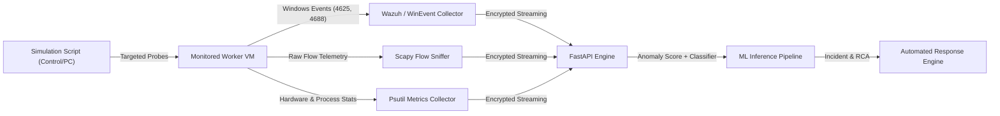

# Attack Simulation & Security Verification Guide

> [!CAUTION]
> **LEGAL AND ETHICAL NOTICE: STRICT TEST SCOPE ONLY**
> 
> The simulation scripts in `scripts/simulate/` are engineered exclusively for controlled, defensive evaluation of the AdaptiveCloud detection and automated response pipeline.
> - **AUTHORIZATION REQUIRED**: You must execute these scripts **ONLY** against monitored cloud worker instances (e.g. your private GCP Windows Server 2022 worker VM) or local sandbox containers that **you personally own and administer**.
> - **PROHIBITED USAGE**: Launching network scans, brute-force attempts, or denial-of-service simulations against third-party networks, university intranets, shared hosts, or unowned IP addresses constitutes an illegal cyberattack under applicable computer crime statutes (including the Indian IT Act 2000 Section 66, US CFAA 18 U.S.C. § 1030, and UK Computer Misuse Act).
> - **SAFETY CONSTRAINTS**: All scripts are hardcoded with strict safety ceilings (maximum 5-second duration limits, low rate limits, tiny wordlists, bounded sandbox file caps <= 50MB, and automated cleanup) to guarantee **₹0 cost overrun** and zero damage to underlying hosts.

---

## 1. Simulation Architecture

All simulated attacks trigger genuine telemetry across the three detection tiers of AdaptiveCloud:


---

## 2. Simulated Attack Vectors & Expected Outcomes

### Vector 1: Brute-Force Authentication Attempt
- **Script**: `scripts/simulate/ssh_bruteforce.ps1` & `scripts/simulate/ssh_bruteforce.sh`
- **Methodology**: Sends rapid consecutive authentication attempts with invalid credentials against a designated dummy account (`audit_test_user`).
- **Telemetry Generated**: Windows Event ID `4625` (An account failed to log on) and high SYN/FIN connection churn in flow features.
- **Expected Anomaly Score**: $\ge 0.75$.
- **Expected Label**: `brute_force`.
- **Expected Automated Countermeasure**: `block_ip` (firewall drop rule via Netsh / agent executor) or account lockout.

### Vector 2: Multi-Port Scan (Reconnaissance)
- **Script**: `scripts/simulate/port_scan.ps1` & `scripts/simulate/port_scan.sh`
- **Methodology**: Sends TCP SYN probes across top management ports (`21`, `22`, `80`, `443`, `3389`, `8080`, `8443`).
- **Telemetry Generated**: Flow features indicate elevated `syn_flag_count`, low packet duration ($< 0.1\text{s}$), and high distinct destination port counts.
- **Expected Anomaly Score**: $\ge 0.65$.
- **Expected Label**: `port_scan`.
- **Expected Automated Countermeasure**: Source IP added to temporary blocklist with 60-minute TTL.

### Vector 3: SYN Flood Denial-of-Service (Duration Capped)
- **Script**: `scripts/simulate/syn_flood.ps1` & `scripts/simulate/syn_flood.sh`
- **Methodology**: Generates a strictly duration-capped (5-second max) burst of TCP SYN packets to port 80/443 without completing the 3-way handshake.
- **Telemetry Generated**: Flow sniffer records massive spike in `flow_bytes_per_sec` and `bwd_packets_per_sec == 0` with high `syn_flag_count`.
- **Expected Anomaly Score**: $\ge 0.85$.
- **Expected Label**: `ddos`.
- **Expected Automated Countermeasure**: High-severity incident generation, rate-limit restriction, and automatic IP quarantine.

### Vector 4: Suspicious Process Execution
- **Script**: `scripts/simulate/suspicious_process.ps1` & `scripts/simulate/suspicious_process.sh`
- **Methodology**: Executes an unauthorized background test process (e.g., encoded PowerShell listener command or simulated discovery executable `mimikatz_test.exe`).
- **Telemetry Generated**: Windows Event ID `4688` (A new process has been created with command line logging enabled) and host process collector CPU/PID tracking.
- **Expected Anomaly Score**: $\ge 0.80$.
- **Expected Label**: `suspicious_process`.
- **Expected Automated Countermeasure**: `kill_process` executed by agent executor after policy validation.

### Vector 5: Hardware Resource Exhaustion & Disk Fill
- **Script**: `scripts/simulate/resource_stress.ps1` & `scripts/simulate/resource_stress.sh`
- **Methodology**: Applies synthetic CPU/RAM compute pressure for 15 seconds and generates a temporary bounded 40MB file in a temporary sandbox directory, then immediately cleans it up.
- **Telemetry Generated**: Psutil metrics show CPU $> 85\%$, memory commit increase, and Theil-Sen regression detects steep storage fill slope.
- **Expected Detection**: Predictive maintenance capacity forecast triggers warning ($< 7$ days remaining, $> 85\%$ CPU breach within 15 minutes).
- **Expected Automated Countermeasure**: Maintenance advisory alert logged, capacity warning broadcasted to dashboard.

### Vector 6: Monitored Service Failure & Recovery
- **Script**: `scripts/simulate/service_failure.ps1` & `scripts/simulate/service_failure.ps1`
- **Methodology**: Temporarily stops a monitored allowlisted test service (e.g. `Spooler` or test daemon).
- **Telemetry Generated**: Agent service monitor detects state transition from `RUNNING` to `STOPPED`.
- **Expected Detection**: Predictive maintenance service risk flagged.
- **Expected Automated Countermeasure**: `restart_service` dispatched via agent executor to restore service uptime.

---

## 3. Running Simulations Safely

### From Windows (PowerShell 7)
```powershell
# Run individual attack simulation against target worker IP
.\scripts\simulate\ssh_bruteforce.ps1 -TargetIp "100.x.y.z" -TargetPort 22

# Run complete orchestrated simulation suite
.\scripts\simulate\run_all_simulations.ps1 -TargetIp "100.x.y.z"
```

### From Linux / WSL
```bash
chmod +x scripts/simulate/*.sh
./scripts/simulate/run_all.sh --target 100.x.y.z
```

